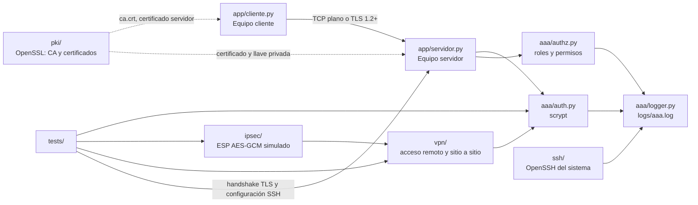

# Comunicaciones seguras

Proyecto en Python para demostrar y comparar TLS, PKI, SSH,
IPSec, VPN y AAA (autenticación, autorización y registro). El proyecto no
implementa una pila de red de producción: IPSec y las VPN se modelan en
memoria para poder observar sus decisiones y encapsulados.

## Aportes
Cristian Uriel Galvan Peña 234598 

## Arquitectura



### Componentes

- **`app/`** contiene un protocolo de comandos TCP sencillo. El servidor
  acepta `LOGIN`, `GET`, `ECHO` y `QUIT`; `GET` exige autenticación y
  autorización. El modo `tls` usa `ssl.SSLContext` con TLS 1.2 como mínimo.
- **`pki/`** crea una CA RSA, un certificado de servidor con SAN DNS/IP y
  cuatro certificados inválidos para probar la verificación.
- **`aaa/`** separa autenticación con `scrypt`, autorización por rol y
  auditoría JSON Lines.
- **`ipsec/`** representa paquetes IP y encapsula ESP con AES-GCM. Incluye
  modo transporte, modo túnel y ventana anti-replay de 64 secuencias.
- **`vpn/`** contiene dos simulaciones: acceso remoto con sesión, token,
  expiración, IP virtual y política por rol; y sitio a sitio entre dos
  gateways con redes CIDR y clave precompartida.
- **`ssh/`** prepara una configuración de OpenSSH y analiza eventos de
  `auth.log`; no contiene un servidor SSH propio.
- **`tests/`** contiene las pruebas unitarias y la demostración completa.

## Requisitos

- Python **3.11 o superior**.
- Paquetes de [`requirements.txt`](requirements.txt): `cryptography` y
  `pytest`.
- Para PKI: Bash y OpenSSL CLI.
- Para la demostración SSH real: Ubuntu (o un sistema con OpenSSH server),
  privilegios `root`, `ssh`, `sshpass` y `systemctl`.
- Dos equipos que puedan comunicarse por TCP para la demostración
  cliente-servidor. Un arreglo habitual es:
  - **Equipo servidor (A):** Ubuntu Server con OpenSSH y el repositorio.
  - **Equipo cliente (B):** Windows con Python y Git Bash, o Ubuntu.
- El proyecto se probó con un servidor Kali en VirtualBox (red Host-Only
  192.168.56.0/24) y un cliente Windows.

Los módulos Python de AAA, IPSec y VPN no necesitan dos equipos porque se
ejecutan localmente. La comunicación de `app/` sí usa la red real.

## Instalación

### En Windows (PowerShell)

Desde la raíz del proyecto:

```powershell
py -3 --version
py -3 -m venv .venv
.\.venv\Scripts\python.exe -m pip install -r requirements.txt
```

Si `py -3` no existe, instale Python 3.11+ y use el ejecutable configurado
en su entorno. Para ejecutar los scripts `.sh` de PKI puede usar Git Bash o
WSL; `Makefile` y los scripts SSH están escritos para un entorno Unix.
Es posible que `make` no exista en Windows; en ese caso, con el entorno
virtual activo, use `python -m pytest -q` en lugar de `make test`.

### En Ubuntu o Kali (Bash)

Desde la raíz del proyecto:

```bash
python3 -m venv .venv
source .venv/bin/activate
pip install -r requirements.txt
```

En Kali puede faltar `/var/log/auth.log`, que es el archivo que lee por
defecto `ssh/analizar_logs.py`. Para que exista, instale rsyslog:

```bash
sudo apt install -y rsyslog
```

El analizador reconoce tanto las líneas `sshd[pid]:` como las
`sshd-session[pid]:` que registran las versiones recientes de OpenSSH.

Los scripts `.sh` requieren permiso de ejecución (`chmod +x script.sh`);
también pueden lanzarse con `bash script.sh`.

## Ejecución paso a paso

Los comandos siguientes parten de la raíz del repositorio. En Windows use
`py -3`; en Ubuntu use `python3` (o `python` con el entorno virtual activo).

### Escena 0: identificar las máquinas

En A (servidor) y B (cliente), anote el hostname y la IP antes de copiar
archivos:

```bash
hostname
hostname -I       # Ubuntu
ipconfig           # Windows
```

### Escena 1: PKI y certificados TLS

En un entorno Bash, genere el material con el nombre DNS y la IP que usará el
cliente para conectarse:

```bash
./pki/01_crear_ca.sh
./pki/02_crear_cert_servidor.sh servidor.ejemplo.test 192.0.2.10
./pki/03_crear_certs_invalidos.sh servidor.ejemplo.test 192.0.2.10
./pki/verificar_pki.sh servidor.ejemplo.test 192.0.2.10
```

Los archivos aparecen en `pki/out/`: `ca.crt`, `ca.key.pem`,
`servidor.crt`, `servidor.key.pem` y `invalidos/` con certificados y llaves
solo para pruebas. La CA es
RSA de 4096 bits con vigencia de diez años; el certificado del servidor es
RSA de 2048 bits, válido un año, `CA:FALSE`, `serverAuth` y SAN para el DNS y
la IP indicados. La llave privada de la CA y la del servidor deben
protegerse y no compartirse con el cliente.

Para comprobar solo la cadena:

```bash
openssl verify -CAfile pki/out/ca.crt pki/out/servidor.crt
```

La comprobación de hostname se hace con `-verify_hostname` o, durante la
conexión Python, con `check_hostname = True`. `openssl verify -CAfile` por sí
solo comprueba la cadena, no el nombre DNS.

Después de generar la PKI, copie a B únicamente la CA:

```bash
scp pki/out/ca.crt usuario@IP_DE_B:/ruta/al/proyecto/pki/out/ca.crt
```

Si se regenera la PKI, vuelva a copiar `ca.crt`.

Para la escena de certificados inválidos, en A inicie cada caso:

```bash
./pki/servir_invalido.sh autofirmado
./pki/servir_invalido.sh otra_ca
./pki/servir_invalido.sh expirado
./pki/servir_invalido.sh hostname
```

En B, con la CA válida, los cuatro casos deben terminar con mensajes
distintos (`self-signed certificate`, emisor desconocido, certificado
expirado y hostname incorrecto). Pruebe además un hostname incorrecto:

```bash
python3 -m app.cliente --modo tls --host IP_DE_A --puerto 8443 \
  --ca pki/out/ca.crt --server-hostname nombre.incorrecto \
  --comando "QUIT"
```

Todos deben imprimir `TLS rechazado`.

### Escena 2: aplicación TCP/TLS en dos computadoras

#### Preparación en el equipo servidor (A)

1. Genere la PKI en A, usando la IP real de A en el SAN. Si el certificado se
   generó con `servidor.ejemplo.test`, resuelva ese nombre en B o conecte
   usando una IP incluida en el SAN.
2. Permita el puerto elegido en el firewall de A.
3. Inicie el servidor plano:

```powershell
py -3 -m app.servidor --modo plano --host 0.0.0.0 --puerto 8443
```


#### Prueba desde el equipo cliente (B)

Sustituya `192.0.2.10` por la IP de A:

```powershell
py -3 -m app.cliente --modo plano --host 192.0.2.10 --puerto 8443 `
  --comando "LOGIN admin Admin123!" `
  --comando "GET administracion_red" `
  --comando "ECHO mensaje visible" `
  --comando "QUIT"
```

En Bash:

```bash
python3 -m app.cliente --modo plano --host 192.0.2.10 --puerto 8443 \
  --comando "LOGIN admin Admin123!" \
  --comando "GET administracion_red" \
  --comando "ECHO mensaje visible" \
  --comando "QUIT"
```

Detenga A con `Ctrl+C` y arránquelo en TLS:

```powershell
py -3 -m app.servidor --modo tls --host 0.0.0.0 --puerto 8443 `
  --cert pki/out/servidor.crt --key pki/out/servidor.key.pem
```

En B, copie únicamente `pki/out/ca.crt` y úselo para validar al servidor:

```powershell
py -3 -m app.cliente --modo tls --host 192.0.2.10 --puerto 8443 `
  --ca pki/out/ca.crt --server-hostname servidor.ejemplo.test --verbose `
  --comando "LOGIN admin Admin123!" `
  --comando "ECHO mensaje cifrado" `
  --comando "QUIT"
```

El cliente exige certificado (`CERT_REQUIRED`), valida la cadena contra la CA
indicada y valida el hostname. `--verbose` muestra versión TLS, cipher suite,
emisor, sujeto y vigencia. Si el SAN no coincide con el nombre usado,
conecte con `--server-hostname` igual al DNS del certificado, sin desactivar
la verificación.

Para observar la diferencia en Wireshark use `tcp.port == 8443`. En plano se
pueden leer los comandos y la contraseña siguiendo el flujo TCP; con TLS se
observan los mensajes y registros TLS, pero no el contenido de los comandos.
Los detalles están en [`docs/captura_plano_vs_tls.md`](docs/captura_plano_vs_tls.md).

### Escena 3: SSH real en el equipo servidor

Este paso modifica el servicio SSH del sistema y requiere Ubuntu como `root`.
En B, genere la llave privada y pública. La privada nunca sale de B:

```bash
ssh-keygen -t ed25519 -f ~/.ssh/sshadmin_ed25519 -N ''
scp ~/.ssh/sshadmin_ed25519.pub usuario@192.0.2.10:/tmp/sshadmin_ed25519.pub
ssh usuario@192.0.2.10 "sudo bash /ruta/al/proyecto/ssh/configurar_ssh.sh \
  -k /tmp/sshadmin_ed25519.pub -p yes"
```

El script crea `sshadmin` y `sshintruso`, bloquea sus contraseñas, instala
`authorized_keys` para `sshadmin`, limita `AllowUsers` a ese usuario, valida
`sshd -t` y recarga el servicio. `-p yes` se usa solo para demostrar el
rechazo de una contraseña incorrecta; en una instalación real use `-p no`.

Instale `sshpass` en B y ejecute la prueba desde B:

```bash
sudo apt-get install -y sshpass
SSH_HOST=192.0.2.10 SSH_KEY=~/.ssh/sshadmin_ed25519 \
  tests/ssh/prueba_ssh.sh
```

La prueba verifica acceso autorizado, rechazo de `sshintruso` y rechazo de
una contraseña incorrecta. Por defecto el script de prueba usa
`StrictHostKeyChecking=no` y descarta `known_hosts`, una decisión conveniente
para la demostración pero no apropiada para producción. Para analizar los
eventos del OpenSSH de A, use `sudo` en A:

```bash
ssh usuario@192.0.2.10 "sudo python3 /ruta/al/proyecto/ssh/analizar_logs.py /var/log/auth.log"
```

El analizador reconoce accesos aceptados, fallidos y usuarios fuera de
`AllowUsers`, y los copia al formato de auditoría de AAA.

### Escena 4: IPSec simulado

Ejecute las pruebas del modelo:

```powershell
py -3 -m pytest -q tests/test_ipsec.py
```

También puede mostrar la comparación:

```bash
python3 -c "from ipsec.comparacion import mostrar_comparacion; mostrar_comparacion()"
```

```bash
python3 -m ipsec.demo_replay
```

En modo transporte, `ipsec.modo_transporte.proteger` cifra el payload y
conserva las IP originales. En modo túnel,
`ipsec.modo_tunel.encapsular` serializa y cifra el paquete IP completo y
expone las IP de los gateways. AES-GCM autentica el encabezado ESP como AAD;
`VentanaAntiReplay` acepta secuencias nuevas y fuera de orden dentro de una
ventana de 64, y registra duplicados o secuencias antiguas como rechazados.

### Escena 5: VPN de acceso remoto y sitio a sitio simuladas

```powershell
py -3 -m pytest -q tests/test_vpn.py
```

`GatewayAccesoRemoto` autentica contra AAA, asigna una IP de
`10.250.0.0/24`, crea un token con expiración de ocho horas y vuelve a
autorizar cada solicitud por rol y recurso. `GatewaySitio` enlaza las redes
`10.1.0.0/24` y `10.2.0.0/24` cuando ambos gateways tienen la misma clave;
solo enruta paquetes entre esas redes y encapsula mediante el modo túnel.
No se crean interfaces, rutas ni sockets VPN del sistema.

```bash
python3 -m vpn.demo_acceso_remoto
python3 -m vpn.demo_sitio_a_sitio
```

### Escena 6: AAA

Use el mismo usuario `invitado` para mostrar autenticación correcta y
autorización denegada:

```bash
python3 -c "from aaa import auth, authz; u='invitado'; print('autenticación:', auth.autenticar(u, 'Invitado123!', '127.0.0.1')); print('autorización reportes/crear:', authz.autorizar(u, 'reportes', 'crear', '127.0.0.1'))"
```

Las cuentas están en [`aaa/usuarios.json`](aaa/usuarios.json); las
contraseñas son didácticas y no deben reutilizarse.

## Comandos del guion que cambiaron

- Se añadió la Escena 0, la copia `scp` de `ca.crt` y el aviso de recopia.
- Los certificados inválidos se sirven con `pki/servir_invalido.sh <tipo>` y
  se documentan los cuatro rechazos más el hostname incorrecto.
- SSH genera la llave en B, copia solo `.pub`, instala `sshpass` en B y usa
  `sudo` para analizar_logs.py.
- Se añadieron los tres módulos `demo_*` de IPSec/VPN.
- AAA usa `invitado` tanto para autenticación OK como para autorización
  denegada.

## Función de TLS, PKI, SSH, IPSec y VPN

- **TLS:** protege la conexión TCP de la aplicación con confidencialidad,
  integridad y autenticación del servidor mediante `ssl`.
- **PKI:** la CA firma el certificado del servidor; el cliente confía
  explícitamente en `ca.crt`, verifica vigencia, cadena y SAN.
- **SSH:** OpenSSH proporciona un canal seguro y autenticación por llave
  pública; la configuración limita usuarios, reintentos, reenvío X11, agente
  y TCP.
- **IPSec/ESP:** el modelo cifra y autentica payloads con AES-GCM. Transporte
  conserva las IP internas; túnel las oculta dentro de un paquete entre
  gateways. Anti-replay evita reutilizar secuencias aceptadas.
- **VPN de acceso remoto:** representa acceso por usuario y sesión, con IP
  virtual, expiración y autorización por recurso.
- **VPN sitio a sitio:** representa conectividad persistente entre dos redes,
  validando una clave compartida y las redes permitidas.

## Tabla comparativa

| Tecnología/capa | Qué protege | Entre quién |
|---|---|---|
| TLS (transporte/aplicación) | Bytes de la sesión TCP: confidencialidad, integridad y autenticación del servidor | Cliente de `app` y servidor de `app` |
| PKI (identidad para TLS) | Confianza en la identidad y nombre del servidor; no transporta datos por sí sola | Cliente, CA y certificado del servidor |
| SSH (aplicación sobre TCP) | Sesión interactiva/comandos y autenticación de OpenSSH | Cliente SSH y `sshd` del equipo servidor |
| IPSec ESP transporte (red, simulado) | Payload del paquete; deja visibles las IP internas | Dos extremos IP modelados |
| IPSec ESP túnel (red, simulado) | Paquete IP interno completo; deja visibles gateways | Dos gateways modelados |
| VPN acceso remoto (simulada) | Solicitudes de un usuario autenticado y autorizado | Usuario, gateway y recurso |
| VPN sitio a sitio (simulada) | Paquetes entre dos CIDR configurados | Gateway A y gateway B |
| AAA (control de acceso/auditoría) | Identidad, permisos y trazabilidad; no cifra el tráfico | Usuario, aplicación y logger |

## Qué es real y qué es simulado

| Parte | Estado | Evidencia en el código |
|---|---|---|
| TLS | **Real** | `ssl.SSLContext`, TLS mínimo 1.2 y validación del cliente |
| Certificados/CA | **Real** | OpenSSL CLI y certificados X.509 en `pki/out/` |
| SSH | **Real** | OpenSSH del sistema, `sshd_config` y `auth.log` |
| AAA | **Real dentro de la aplicación** | `scrypt`, comparación constante, matriz de roles y JSON Lines |
| ESP/AES-GCM | **Simulado** | `cryptography` cifra objetos `PaqueteIP` en memoria |
| Anti-replay | **Simulado** | ventana Python de 64 secuencias; no inspecciona tráfico del kernel |
| VPN acceso remoto | **Simulada** | token, IP virtual y política en objetos Python |
| VPN sitio a sitio | **Simulada** | dos gateways Python y clave directa; no hay túnel del sistema |

## Resultados de pruebas

La demostración completa se ejecuta con:

```bash
bash tests/demo_completa.sh
```

El script lanza nueve pruebas de `tests/test_demostracion.py`, imprime el
resultado de cada una y actualiza [`docs/resultados.md`](docs/resultados.md).
El resultado registrado más reciente indica **PASS** en:

1. TLS válido.
2. Rechazo de certificados inválidos.
3. Cadena de confianza.
4. SSH autorizado y no autorizado (validación de la configuración de
   OpenSSH; la prueba contra un daemon real está en `tests/ssh/`).
5. IPSec transporte.
6. IPSec túnel.
7. Detección de replay.
8. VPN de acceso remoto.
9. Restricción posterior a la conexión.

Para repetir todas las pruebas Python sin sobrescribir el informe:

```powershell
py -3 -m pytest -q
```

El objetivo `make test` ejecuta pytest y trata correctamente el código 5 de
pytest cuando no hay pruebas. `make demo` llama al script de demostración.
Los objetivos `demo-plano` y `demo-tls` solo imprimen que están pendientes;
use los comandos de las secciones anteriores.

## Limitaciones de seguridad

Este repositorio es didáctico y no debe desplegarse como una solución de
seguridad. En particular:

- No hay **IKE**, negociación de asociaciones de seguridad (SA), intercambio
  de claves, autenticación de peers ni **rekey** para IPSec.
- Las claves, SPI y parámetros criptográficos de la simulación se entregan
  directamente a las funciones; en la VPN sitio a sitio se usa una clave
  precompartida fija de demostración.
- No hay CRL, OCSP, rotación de certificados ni almacén de confianza
  operativo; la revocación X.509 no está implementada.
- IPSec y VPN no usan interfaces, sockets, rutas ni el kernel: no protegen
  paquetes reales del sistema ni crean una VPN conectable desde otra máquina.
- La ventana anti-replay solo protege el objeto Python mientras vive el
  proceso; no existe persistencia, sincronización entre peers ni gestión de
  SA.
- No hay protección DoS: el servidor acepta conexiones y crea hilos sin
  rate limiting, cuotas, back-pressure ni mecanismo de bloqueo distribuido.
- El protocolo de comandos no limita autenticaciones fallidas por usuario o
  IP. El límite de longitud de línea es de 64 KiB, pero no sustituye
  controles operativos.
- El servidor registra el intento de handshake TLS rechazado en consola, pero
  no lo integra en el log JSON de AAA.
- La prueba SSH desactiva deliberadamente la verificación de host y usa
  `sshpass` para el caso negativo; no copie esas opciones a producción.
- El `ECHO` acepta texto del cliente y el servidor está pensado para una red
  de laboratorio. No hay gestión de cuentas, secretos, auditoría remota,
  rotación de logs ni alta disponibilidad.
- Los secretos de `aaa/usuarios.json`, las claves de IPSec/VPN y las
  contraseñas del README son solo material de prueba.

## Limpieza

Para eliminar artefactos locales generados por PKI, caché de pytest,
`__pycache__` y el directorio de logs use el objetivo existente:

```bash
make clean
```

Revise antes los archivos que quiera conservar: el objetivo elimina
`pki/out/`, `.pytest_cache/`, directorios `__pycache__/` y `logs/`.
